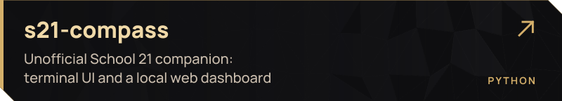
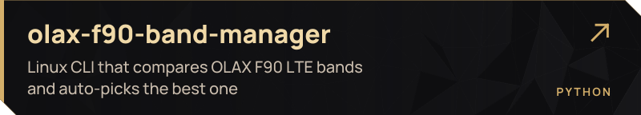
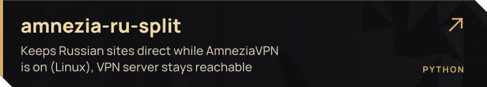
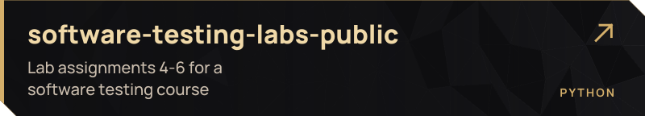

  

  I write Python and C++, build random Linux tools, and sometimes make stuff look way better than it needs to. Most of it lives below. Poke around.

<h3 align="center"></h3>

 
 
 

<h3 align="center"></h3>

  

  &copy; 2026 kissabmi. Banner, cards and cat artwork: all rights reserved.

